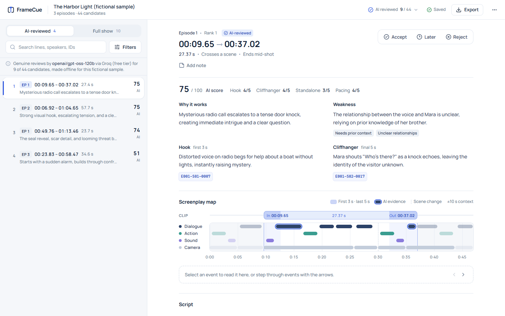

# FrameCue

FrameCue finds and ranks 20–60 second promo clips in timestamped microdrama screenplays.

**Live site:** https://framecue-app.vercel.app

## Overview

Microdrama platforms release many short episodes and need a steady supply of promo clips:
a moment that hooks a viewer in the first seconds and ends on a question they want answered.
Finding those moments by reading every script is slow.

FrameCue reads the screenplays, proposes continuous 20–60 second clips with exact
timestamps, ranks them, and gives an editor a workspace to review, annotate and export a
shortlist. It is meant for promo editors and marketing teams; the output is a starting point
for editorial judgement, not a replacement for it.



## Features

- Upload one `.zip` pack or individual `.txt` episodes (up to 4 MB online; any size with the
  command-line tool).
- Candidate clips of 20–60 seconds that start and end on structural boundaries (scene
  changes, lines, actions, camera cuts), each with `MM:SS.cc` timecodes.
- A structural score (0–1) for every candidate, explained in plain language.
- Optional AI reviews: hook, cliffhanger, standalone clarity and pacing, a 0–100 score, and
  the screenplay events each judgement cites. Reviews are produced offline and checked
  against the screenplay before they are shown.
- AI-reviewed and structural rankings shown as separate lists; their scores are never mixed.
- A screenplay map of each clip with its surrounding context, and the script excerpt.
- Search and filters (episode, duration, AI status, warnings, your decision).
- Accept, later and reject decisions (keys `A`, `L`, `R`) and private notes.
- Saved analyses in the browser: reopen, rename and delete, with duplicate-upload detection.
- Exports: ranked list and shortlist (CSV or JSON), the analysis document, and a backup of
  every saved analysis that can be imported in another browser.
- A fictional three-episode sample, *The Harbor Light*, to try the workflow without your own
  files.

## How it works

1. **Parse.** Each episode becomes a list of timed events: dialogue, action, sound and
   camera directions, grouped into scenes.
2. **Generate candidates.** Clips of 20–60 seconds are cut at structural boundaries and
   checked against hard rules on length and boundaries.
3. **Score structurally.** A deterministic baseline scores each clip from six signals:
   opening, ending, activity, clean boundaries, duration fit and context. This needs no model
   and runs in seconds for a 50-episode pack.
4. **Review with AI (optional).** The command-line tool sends selected clips to a language
   model (GroqCloud `openai/gpt-oss-120b`, free plan). The model rates the hook (first 3 s),
   cliffhanger (last 5 s), standalone clarity and pacing on 1–5 scales and must cite event
   IDs as evidence. A review is kept only if every cited event exists inside the right part of
   the clip.
5. **Rank.** AI-reviewed clips are ranked by their 0–100 score; all clips are also ranked by
   the structural score. A clip that mostly overlaps a better one is listed as an alternative
   cut instead of a separate pick.

The structural score measures shape, not storytelling quality. Only the AI review makes an
editorial judgement, and it is still one model's estimate.

## Architecture

| Part | Technology | Role |
|---|---|---|
| Frontend | React 19, TypeScript, Vite, Tailwind | Upload, review workspace, exports |
| Backend | Python 3.11+, FastAPI | Parsing, candidates, scoring, validation of AI reviews |
| AI evaluator | GroqCloud API (command line only) | Produces AI reviews offline, within the free quota |
| Hosting | Vercel | Static frontend on the CDN; one stateless Python function for `/api` |
| Persistence | IndexedDB in the browser | Saved analyses, decisions and notes |

The deployed API has two routes, `GET /api/health` and `POST /api/analyze`. It is stateless
and never calls a model. AI reviews reach the website only as a bundle uploaded with the
screenplay, which the server re-validates against that screenplay.

## Getting started

**Prerequisites:** Python 3.11 or later and Node.js 24. The commands below use Windows
paths; on macOS or Linux use `.venv/bin/` instead of `.venv\Scripts\`.

Install the backend:

```bash
python -m venv .venv
```

```bash
.venv\Scripts\python -m pip install -e ".[dev]"
```

Install the frontend:

```bash
cd frontend && npm ci
```

**Environment variables** are needed only for live AI evaluation. Copy `.env.example` to
`.env` (gitignored) and set:

- `FRAMECUE_LLM_API_KEY` (or `GROQ_API_KEY`): a GroqCloud key on the free plan;
- `FRAMECUE_DAILY_TOKEN_BUDGET` (optional): tokens per UTC day, default 180,000.

Start the backend (http://127.0.0.1:8000):

```bash
.venv\Scripts\framecue serve --port 8000
```

Start the frontend (http://localhost:5173, with `/api` proxied to port 8000):

```bash
cd frontend && npm run dev
```

## Usage

**Analyze a screenplay.** Drop a `.zip` pack or `.txt` episodes on the start page and choose
**Analyze**. Without an AI bundle, clips are ranked by structure and the list says that AI
review is not available.

**Try the sample.** Choose **Try the fictional sample**. It runs an invented three-episode
story through the real API together with genuine AI reviews of 9 of its 44 candidates
(`openai/gpt-oss-120b` on GroqCloud's free plan, made offline and published in
`frontend/public/sample/`). The server re-validates them against the sample like any other
uploaded bundle.

**Add AI reviews.**

1. Plan the run without calling the model:

   ```bash
   .venv\Scripts\framecue evaluate --zip "data\private\pack.zip" --schedule coverage-first --levels 1
   ```

2. Add `--allow-large --live` to evaluate. Requests are paced to the free plan's limits and
   stop at the daily budget; results are cached in `runs\cache\evaluations`.
3. Export the cached reviews:

   ```bash
   .venv\Scripts\framecue export-ai --out runs\ai_bundle.json
   ```

4. Upload `runs\ai_bundle.json` as the **AI evaluation bundle** together with the same
   screenplay. Reviews that do not match the screenplay or fail validation are ignored and
   counted.

**Save and export.** Every analysis is saved in the browser automatically. **Recent
analyses** on the start page reopens, renames or deletes them, and **Back up all** downloads
a file that **Import** restores elsewhere. Inside an analysis, **Export** offers the ranked
list, your shortlist and the analysis document.

**Command line.**

| Command | Purpose |
|---|---|
| `framecue analyze <zip, txt or folder> --out <dir>` | Offline analysis; writes rankings, CSVs and a manifest |
| `framecue serve --port 8000` | Local API for the frontend |
| `framecue evaluate --zip <path> [--live]` | Opt-in AI evaluation (dry run without `--live`) |
| `framecue export-ai --out <file>` | Bundle cached AI reviews for upload |

`analyze` never calls a model and prints counts, IDs and scores, never screenplay text.

## Testing

Python tests and lint:

```bash
.venv\Scripts\python -m pytest
```

```bash
.venv\Scripts\ruff check .
```

Frontend unit tests (Vitest, with a fake IndexedDB):

```bash
cd frontend && npm test
```

End-to-end tests (Playwright, using the installed Microsoft Edge against the real `app.py`):

```bash
cd frontend && npm run build && npx playwright test
```

Set `E2E_BASE_URL` to run the same specs against a deployment. Tests that need the private
screenplay pack are skipped unless `FRAMECUE_TEST_ZIP` points to it. CI runs Ruff, pytest,
the TypeScript check, the build and Vitest on every push.

## Deployment

The repository deploys to Vercel as one project:

- `app.py` is the Python entrypoint; `.python-version` selects Python 3.12.
- `vercel.json` builds the frontend (`npm --prefix frontend ci && npm --prefix frontend run
  build`), sends unknown non-API paths to `index.html`, and allows the function 60 s.
- `.vercelignore` is an allowlist: only the app, `src/`, `frontend/` and build settings are
  uploaded. ZIPs, PDFs, `runs/`, `data/`, `.env` files and private AI bundles are excluded.

```bash
npx vercel@65.4.0 deploy
```

```bash
npx vercel@65.4.0 deploy --prod
```

**Limits:** uploads up to 4 MB (Vercel's request limit is 4.5 MB); larger inputs need the
command-line tool. The function runs in one US region, so a full 50-episode pack takes a few
seconds from India.

## Limitations

- **Partial AI coverage.** AI reviews exist only where the free quota allowed: 41 of the 788
  candidates in the 50-episode assignment pack and 9 of the 44 in the fictional sample. The
  AI ranking is provisional, and the rest are ranked by structure only.
- **AI judgements are estimates.** Scores come from one model and were checked by rubric
  review, not by human labels or viewer data. Evidence IDs are validated; the wording of
  explanations is not.
- **Continuous clips only.** Each clip is one continuous stretch; montages of several moments
  are not generated.
- **No video.** FrameCue works on screenplays and does not cut or render video.
- **Screenplay time is not video time.** Timecodes come from the screenplay. Edits, pacing
  and music in the final video can shift them.
- **Provider quotas.** Live evaluation depends on GroqCloud's free daily and per-minute
  limits. When they run out, evaluation stops until the next day.
- **Browser storage.** Saved analyses stay in one browser on one device and are separate for
  each site address. Use **Back up all** and **Import** to move them.

## Privacy

- Confidential screenplays, outputs, caches and raw model responses are gitignored (`data/`,
  `runs/`) and excluded from deployments. Tests use invented fixtures.
- API keys live only in `.env` on the machine that runs the evaluator. The website never
  receives a key and never calls a model.
- Uploads are processed in memory for the duration of the request and not stored.
- Saved analyses stay in the browser's IndexedDB; no cookies, localStorage or URL parameters
  carry screenplay data.
- The public sample and any AI reviews published for it are fictional.

## Development notes

The architecture, decisions and measurements are in [docs/PLAN.md](docs/PLAN.md) and the HTTP
contract in [docs/API.md](docs/API.md). The project was built with an AI coding assistant;
[docs/AI_LOG.md](docs/AI_LOG.md) records how it was used.
